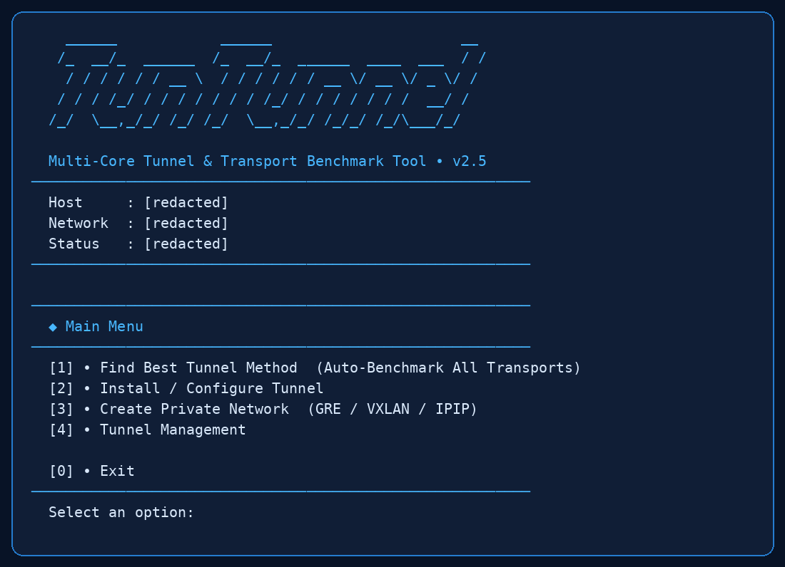

<div dir="rtl">

# TunTunnel؛ راه‌اندازی تانل بین دو سرور لینوکس و مقایسه روش‌های اتصال

[English](README.md) | **فارسی**

وقتی اتصال بین دو سرور ناپایدار است، انتخاب یک پروتکل از روی اسم یا تجربه دیگران کافی نیست. TunTunnel ابزاری ترمینالی برای ساخت تانل، مدیریت شبکه خصوصی و مقایسه روش‌های اتصال روی مسیر واقعی شماست. می‌توانید چند روش را آزمایش کنید، نتیجه انتقال داده را ببینید و سپس اتصال موردنیازتان را بسازید.

این راهنما نصب TunTunnel، ایجاد تانل بین سرور ایران و خارج، بنچمارک شبکه و عیب‌یابی اتصال را توضیح می‌دهد. منوی خود برنامه انگلیسی است؛ نام گزینه‌ها در ادامه همان عبارتی است که در ترمینال می‌بینید.



*تصویر منوی واقعی برنامه؛ اطلاعات مختص سرور پوشانده شده‌اند.*

## فهرست راهنما

- [قابلیت‌ها و روش‌های اتصال](#features)
- [پیش‌نیازها](#requirements)
- [نصب روی لینوکس](#installation)
- [ساخت تانل بین دو سرور](#create-tunnel)
- [بنچمارک و انتخاب روش اتصال](#benchmark)
- [شبکه خصوصی GRE، VXLAN و IPIP](#private-network)
- [مدیریت تانل و دستورهای کاربردی](#management)
- [نصب نسخه باینری](#binary)
- [فایل‌ها و نکات امنیتی](#security)
- [عیب‌یابی](#troubleshooting)
- [حذف برنامه](#uninstall)
- [پرسش‌های رایج](#faq)

<a id="features"></a>
## قابلیت‌ها و روش‌های اتصال

TunTunnel تنظیمات اتصال و سرویس‌های موردنیاز را مدیریت می‌کند؛ اجرای انتقال داده بر عهده موتورهایی مانند sing-box، Xray، BackPack و daggerConnect است. دانلود موتور، دسترسی به انتشارهای بالادستی و پشتیبانی شبکه روی امکان استفاده از هر روش اثر دارد.

| بخش | کاربرد |
| --- | --- |
| `Find Best Tunnel Method` | مقایسه روش‌های انتقال بین دو سرور با بنچمارک |
| `Install / Configure Tunnel` | ساخت اتصال یا پیوستن با لینک راه‌اندازی |
| `Create Private Network` | ایجاد، نمایش و حذف شبکه‌های خصوصی ثبت‌شده در برنامه |
| `Tunnel Management` | بررسی وضعیت، لاگ و مدیریت سرویس‌های تانل |
| `Uninstall` | حذف محلی برنامه پس از تهیه و بررسی نسخه پشتیبان |

پروفایل‌های موجود در کد پروژه شامل این خانواده‌ها هستند:

- **TCP و مالتی‌پلکس روی TLS:** `tcp-tls`، `smux-tls`، `yamux-tls` و `h2mux-tls`.
- **انتقال‌های مبتنی بر وب:** `wss`، `wss-smux`، `grpc-tls`، `h2-tls`، `httpupgrade-tls`، `xhttp-tls`، `xray-wss` و `xray-grpc`.
- **روش‌های مبتنی بر UDP:** `quic-tls`، `mkcp-chacha` و `mkcp-aes`.
- **روش‌های دیگر:** `tcp-stealth`، `icmp-aes` و خانواده `dagger-*`.

وجود یک پروفایل در منو به معنی کارکرد قطعی آن در همه دیتاسنترها نیست. برای نمونه، روش‌های خام به مجوز شبکه و پشتیبانی کرنل نیاز دارند؛ روش‌های UDP نیز روی مسیری که UDP را مسدود می‌کند قابل اتکا نیستند.

<a id="requirements"></a>
## پیش‌نیازها

- دو سرور لینوکس با مسیر ارتباطی قابل‌دسترسی بین آن‌ها.
- دسترسی `root` برای نصب، ساخت اینترفیس و مدیریت سرویس‌ها.
- `systemd`، `Bash`، `Python 3`، `OpenSSL` و دستور `ip` از بسته `iproute2`.
- `curl` و دسترسی HTTPS برای دریافت برنامه و موتورهای موردنیاز.
- مجاز بودن پورت‌ها و پروتکل موردنیاز در فایروال سرور و فایروال ارائه‌دهنده.

منطق دریافت موتور از معماری‌های `x86_64` و `aarch64` پشتیبانی می‌کند؛ موجود بودن فایل مناسب به انتشار هر موتور هم وابسته است. باینری آماده خود TunTunnel در بخش انتشارها مخصوص Linux x86-64 است.

<a id="installation"></a>
## نصب TunTunnel روی لینوکس

روی **هر دو سرور** با کاربر `root` دستور زیر را اجرا کنید. این دستور فایل را در مسیر دائمی قرار می‌دهد، نحو Bash را بررسی می‌کند و منوی برنامه را باز می‌کند:

</div>

```bash
mkdir -p /usr/local/lib/tunnel-extra /usr/local/bin && curl -fsSL https://raw.githubusercontent.com/mahdiweb3/tuntunnel/main/tunnel-extra.sh -o /usr/local/lib/tunnel-extra/tunnel-extra.sh.new && bash -n /usr/local/lib/tunnel-extra/tunnel-extra.sh.new && chmod 755 /usr/local/lib/tunnel-extra/tunnel-extra.sh.new && mv -f /usr/local/lib/tunnel-extra/tunnel-extra.sh.new /usr/local/lib/tunnel-extra/tunnel-extra.sh && ln -sfn /usr/local/lib/tunnel-extra/tunnel-extra.sh /usr/local/bin/tuntunnel && /usr/local/bin/tuntunnel
```

<div dir="rtl">

برای دفعات بعد نیازی به دریافت دوباره فایل نیست:

</div>

```bash
tuntunnel
```

<div dir="rtl">

> دستور نصب با دسترسی ریشه اجرا می‌شود. پیش از اجرا، منبع و محتوای اسکریپت را بررسی کنید. بررسی نحو Bash جای ممیزی امنیتی کد را نمی‌گیرد.

<a id="create-tunnel"></a>
## ساخت تانل بین سرور ایران و خارج

۱. TunTunnel را روی هر دو سرور نصب کنید. در سرور اول، `tuntunnel` را باز کنید.
۲. گزینه `Install / Configure Tunnel` و محل سرور را انتخاب کنید.
۳. جهت اتصال، یعنی `Direct` یا `Reverse`، و سپس پروفایل انتقال را مشخص کنید.
۴. نام تانل، IP هر دو سرور، پورت اتصال و نگاشت پورت‌ها را وارد کنید. برای نمونه، `443=443` پورت ورودی ۴۴۳ را به پورت مقصد ۴۴۳ نگاشت می‌کند.
۵. در صورت نیاز، بستر خصوصی GRE، VXLAN یا IPIP را انتخاب کنید؛ ساخت شبکه خصوصی برای همه اتصال‌ها الزامی نیست.
۶. تنظیمات تولیدشده را بررسی و تأیید کنید. لینک راه‌اندازی را در محل امن نگه دارید.
۷. در سرور دوم، همان بخش نصب را باز کنید، محل سرور را انتخاب و لینک راه‌اندازی را وارد کنید. تنظیمات را بررسی و تأیید کنید.
۸. وضعیت هر دو سمت را در `Tunnel Management` ببینید و سرویس مقصد را از مسیر تانل آزمایش کنید.

**بالا بودن سرویس تانل به‌تنهایی کافی نیست.** برنامه‌ای که قرار است ترافیک را دریافت کند نیز باید روی پورت مقصد فعال باشد. مثلاً اگر نگاشت به پورت ۴۴۳ انجام شده، نبود سرویس شنونده روی آن پورت باعث خطای اتصال می‌شود.

<a id="benchmark"></a>
## بنچمارک؛ کدام روش برای مسیر شما مناسب‌تر است؟

۱. روی سرور ایران، `Find Best Tunnel Method` و سپس `Iran Server` را انتخاب کنید.
۲. پیش‌نیازهای پیشنهادی را بررسی کنید و فقط در صورت اعتماد اجازه نصب بدهید. شنونده جفت‌سازی را باز نگه دارید و کلید یک‌بارمصرف را بردارید.
۳. روی سرور خارج، همان بخش و سپس `Foreign Server` را انتخاب کنید. آدرس سرور ایران و کلید را وارد کنید.
۴. آدرس‌های مسیر و گزینه‌های آزمایش را مشخص کنید. اگر برنامه نصب مؤلفه دیگری را خواست، درخواست را بررسی کنید.
۵. نتیجه سرعت انتقال و تأخیر را در هر دو جهت مقایسه کنید. روش‌های فاقد موتور یا پشتیبانی شبکه ممکن است کنار گذاشته شوند.

پینگ پایین لزوماً به معنی سرعت انتقال بالاتر نیست. نتیجه را بر اساس انتقال واقعی داده و محدودیت‌های مسیر بخوانید؛ یک اجرای موفق نیز تضمین پایداری همیشگی نیست.

برنامه تلاش می‌کند موتورهایی را که برای آزمایش نصب کرده پاک کند و نصب‌های قبلی را نگه دارد. اگر آزمایش ناگهانی متوقف شد، هر دو سرور را برای فرایندها و فایل‌های باقی‌مانده بررسی کنید. بسته‌هایی که از مدیر بسته سیستم نصب شده‌اند ممکن است باقی بمانند.

<a id="private-network"></a>
## ساخت و مدیریت شبکه خصوصی GRE، VXLAN و IPIP

در گزینه `Create Private Network`، سه انتخاب اول برای ساخت GRE، VXLAN و IPIP هستند. نوع بستر را با توجه به پشتیبانی دو سرور و محدودیت ارائه‌دهنده انتخاب کنید.

- **`List Networks`:** نام، نوع، اینترفیس، زیرشبکه و وجود اینترفیس روی همین سرور را نشان می‌دهد.
- **`Delete Network`:** پس از تأیید، فقط شبکه محلی انتخاب‌شده را حذف می‌کند؛ سمت مقابل تغییری نمی‌کند. شبکه‌ای که تانل ثبت‌شده از آن استفاده می‌کند، از این بخش قابل حذف نیست.
- اطلاعات شبکه‌های ثبت‌شده در `/etc/tunnel-extra/networks/` نگهداری می‌شود. اینترفیس‌های نامرتبط یا شبکه‌های قدیمیِ ثبت‌نشده خودکار وارد فهرست نمی‌شوند.

> GRE، VXLAN و IPIP به‌خودی‌خود رمزنگاری نیستند. امنیت بستر خصوصی را با رمزنگاری لایه انتقال یکی نگیرید.

<a id="management"></a>
## مدیریت تانل و دستورهای کاربردی

در دستورهای زیر، `NAME` را با نام تانل خود جایگزین کنید.

| کار | دستور |
| --- | --- |
| فهرست تانل‌ها | `tuntunnel list` |
| وضعیت همه تانل‌ها | `tuntunnel status` |
| وضعیت یک تانل | `tuntunnel status NAME` |
| بررسی سلامت | `tuntunnel health NAME` |
| معیارهای اتصال | `tuntunnel metrics NAME` |
| مشاهده لاگ | `tuntunnel logs NAME` |
| شروع سرویس | `tuntunnel start NAME` |
| توقف سرویس | `tuntunnel stop NAME` |
| راه‌اندازی مجدد | `tuntunnel restart NAME` |
| حذف یک تانل | `tuntunnel remove NAME` |
| راهنمای عمومی | `tuntunnel --help` |
| راهنمای ساخت | `tuntunnel create --help` |

برای بررسی تنظیمات پیش از اعمال، دستور `create` از `--dry-run` پشتیبانی می‌کند:

</div>

```bash
tuntunnel create --name demo --profile tcp-tls --iran-ip 192.0.2.1 --abroad-ip 192.0.2.2 --maps 443=443 --dry-run
```

<div dir="rtl">

IPهای این نمونه مخصوص مستندات هستند. هنگام استقرار، آدرس واقعی سرورها را وارد کنید. گزینه‌های تکمیلی مانند `join`، `edit`، `auto-refresh`، `link-up` و `link-down` در راهنمای خط فرمان توضیح داده می‌شوند.

<a id="binary"></a>
## نصب نسخه باینری Linux x86-64

فایل‌های `tuntunnel-linux-amd64` و `SHA256SUMS` را از [آخرین انتشار](https://github.com/mahdiweb3/tuntunnel/releases/latest) دریافت کنید. سپس در پوشه دانلود اجرا کنید:

</div>

```bash
sha256sum --ignore-missing -c SHA256SUMS
chmod 755 tuntunnel-linux-amd64
./tuntunnel-linux-amd64
```

<div dir="rtl">

اگر بررسی checksum ناموفق بود، فایل را اجرا نکنید. تطبیق checksum یکپارچگی فایل با فهرست منتشرشده را بررسی می‌کند؛ جای بررسی اعتبار منبع دانلود را نمی‌گیرد.

این فایل یک راه‌انداز ELF است، نه بسته مستقل تمام وابستگی‌ها. به `Python 3`، ابزارهای سیستمی و `glibc 2.34` یا جدیدتر نیاز دارد. کد تعبیه‌شده از حافظه اجرا می‌شود و به مسیر `/tmp` وابسته نیست.

برای نصب دائمی باینری، با کاربر `root` اجرا کنید:

</div>

```bash
install -d -m 755 /usr/local/lib/tunnel-extra /usr/local/bin
install -m 755 tuntunnel-linux-amd64 /usr/local/lib/tunnel-extra/tunnel-extra.sh
ln -sfn /usr/local/lib/tunnel-extra/tunnel-extra.sh /usr/local/bin/tuntunnel
tuntunnel
```

<div dir="rtl">

پسوند `.sh` برای سازگاری با مسیر سرویس‌ها حفظ شده است. یکی از روش‌های نصب را انتخاب کنید؛ اجرای نصب‌کننده سورس در آینده، باینری را با اسکریپت جایگزین می‌کند.

<a id="security"></a>
## فایل‌ها و نکات امنیتی

| مسیر | محتوا |
| --- | --- |
| `/usr/local/lib/tunnel-extra/tunnel-extra.sh` | مدیر نصب‌شده برنامه |
| `/usr/local/bin/tuntunnel` | لینک فرمان اجرای برنامه |
| `/etc/tunnel-extra` | تنظیمات اتصال و اطلاعات حساس |
| `/opt/tunnel-extra/bin` | موتورهای دریافت‌شده |
| `/etc/systemd/system` | سرویس‌های تولیدشده |

لینک `tuntunnel://`، کد اتصال، کلید خصوصی، تنظیمات زنده و لاگ حاوی اطلاعات حساس را در Issue یا مخزن عمومی منتشر نکنید. دسترسی به پورت شنونده را تا حد امکان به سرور مقابل محدود کنید. پیش از حذف یا تغییر تنظیمات، نسخه پشتیبان بگیرید.

<a id="troubleshooting"></a>
## عیب‌یابی اتصال و خطاهای رایج

| نشانه | چه چیزی بررسی شود؟ |
| --- | --- |
| `command not found` | وجود لینک `/usr/local/bin/tuntunnel`، دسترسی ریشه هنگام نصب و قرار داشتن `/usr/local/bin` در `PATH` |
| خطای دریافت موتور | DNS، دسترسی HTTPS، اتصال به GitHub، معماری پردازنده و انتشار بالادستی |
| تانل متصل نمی‌شود | وضعیت و لاگ هر دو سمت، جهت اتصال، IP، پورت شنونده و فایروال‌ها |
| `connection refused` برای مقصد | فعال بودن سرویس مقصد و درست بودن پورت نگاشت‌شده |
| شبکه خصوصی بالا نمی‌آید | ماژول کرنل، مجاز بودن پروتکل و سیاست شبکه ارائه‌دهنده در هر دو سمت |
| قطع‌و‌وصل هنگام انتقال داده | لاگ هم‌زمان دو سمت، افت بسته، MTU مسیر و سلامت بستر؛ علت را فقط از روی یک خطا قطعی ندانید |
| آزمایش نیمه‌کاره مانده است | فرایندهای تست و فایل‌های موتور باقی‌مانده روی هر دو سرور |

برای دیدن گزینه‌های هر فرمان از `tuntunnel COMMAND --help` استفاده کنید.

<a id="uninstall"></a>
## حذف TunTunnel از سرور

گزینه `Uninstall` در منوی اصلی، تأیید صریح با عبارت `UNINSTALL` می‌خواهد. پیش از حذف، آرشیو خصوصی در `/var/backups/tuntunnel/` ساخته می‌شود. اگر پشتیبان‌گیری یا توقف سرویس‌ها شکست بخورد، حذف فایل‌ها ادامه پیدا نمی‌کند.

این عملیات سرویس‌های TunTunnel را متوقف و تنظیمات، اینترفیس‌های محلی ثبت‌شده، پوشه موتورهای خصوصی و فرمان‌های برنامه را حذف می‌کند. سرور مقابل و موتورهای مشترک در `/usr/local/bin` دست‌نخورده می‌مانند. اینترفیس‌های قدیمیِ ثبت‌نشده خودکار شناسایی نمی‌شوند.

**آرشیو پشتیبان ممکن است اطلاعات اتصال و کلیدها را داشته باشد؛ آن را عمومی نکنید.**

<a id="faq"></a>
## پرسش‌های رایج

### آیا TunTunnel روی هر دو سرور نصب می‌شود؟

بله. برای راه‌اندازی معمول، ابزار روی هر دو سمت نصب می‌شود و تنظیمات سمت دوم با لینک راه‌اندازی منتقل می‌شود.

### برای تانل ایران و خارج، SMUX-TLS بهتر است یا روش‌های دیگر؟

پاسخ ثابت ندارد. کیفیت مسیر، محدودیت TCP یا UDP، افت بسته و نوع ترافیک نتیجه را تغییر می‌دهند. پروفایل `smux-tls` در برنامه موجود است؛ برای مقایسه، بنچمارک را روی همان دو سرور اجرا کنید و اتصال منتخب را زیر بار واقعی بسنجید.

### آیا ساخت GRE برای همه تانل‌ها لازم است؟

خیر. بستر خصوصی اختیاری است و باید بر اساس نیاز و پشتیبانی شبکه انتخاب شود.

### آیا دستور نصب به فایل موقت وابسته می‌ماند؟

خیر. مدیر برنامه در `/usr/local/lib/tunnel-extra/` نصب می‌شود و فرمان `tuntunnel` به همان مسیر اشاره دارد.

### آیا ابزار پایداری یا سرعت مشخصی را تضمین می‌کند؟

خیر. برنامه ساخت و مقایسه اتصال‌ها را آسان می‌کند؛ مسیر شبکه، فایروال، منابع سرور و موتور انتقال همچنان تعیین‌کننده‌اند.

## مشارکت و مجوز

برای گزارش خطا، نام پروفایل، جهت اتصال، سیستم‌عامل و بخش مرتبط لاگ را همراه با حذف اطلاعات حساس ارائه کنید. [ثبت Issue](https://github.com/mahdiweb3/tuntunnel/issues) محل گزارش مشکلات پروژه است.

در حال حاضر مجوزی در مخزن درج نشده است؛ عمومی بودن کد به‌تنهایی اجازه استفاده یا بازتوزیع نامحدود نیست. موتورهای خارجی نیز مجوزهای مستقل خود را دارند.

</div>
