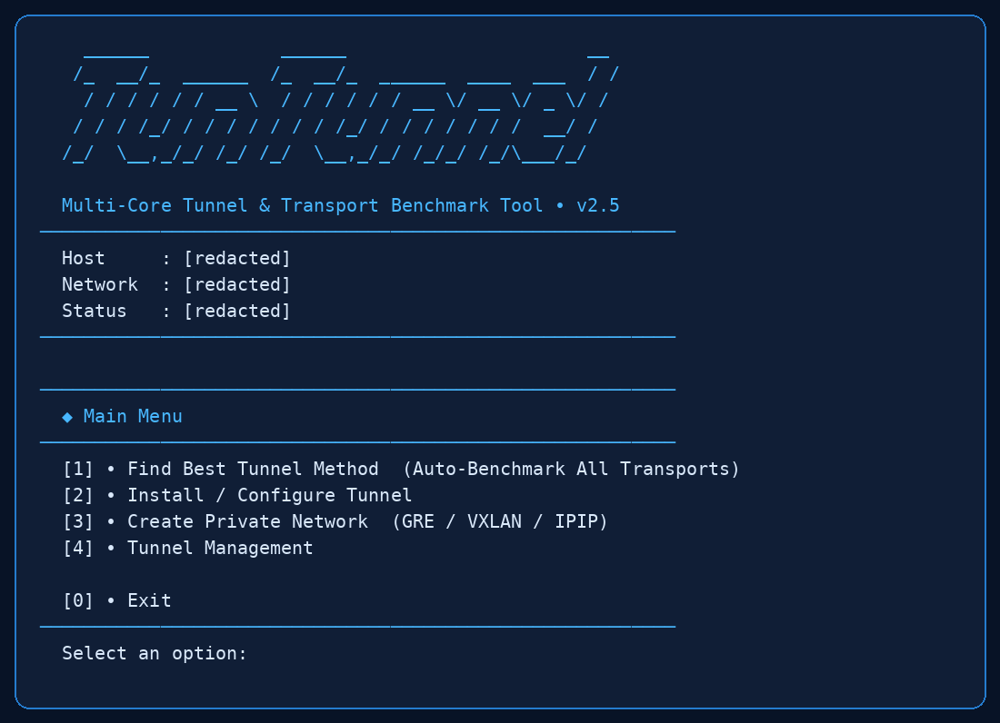

# TunTunnel

A Linux terminal tool for configuring tunnels, private network carriers, and comparing transport methods across two servers. The interactive interface uses a blue terminal theme.



*Main menu captured from the script. Host-specific details were redacted.*

## Contents

- [Requirements](#requirements)
- [Installation](#installation)
- [Create a tunnel](#create-a-tunnel)
- [Benchmark](#benchmark)
- [Management](#management)
- [Command-line reference](#command-line-reference)
- [Files and security](#files-and-security)
- [Troubleshooting](#troubleshooting)

## Main menu

| Option | Purpose |
| --- | --- |
| Find Best Tunnel Method | Compare available tunnel transports between two servers. |
| Install / Configure Tunnel | Create a tunnel or join using a setup link. |
| Create Private Network | Configure GRE, VXLAN, or IPIP carrier networks. |
| Tunnel Management | View and manage configured tunnels. |

## Requirements

| Requirement | Details |
| --- | --- |
| Servers | Two Linux servers with network connectivity between them. |
| Privileges | Root for installation, network interfaces, and services. |
| System | `systemd`, `ip` from iproute2, Python 3, Bash, and OpenSSL. |
| Download | `curl` for the installer; outbound HTTPS for downloading engines. |
| Architecture | Engine download logic supports `x86_64` and `aarch64`. |
| Firewall | Permit the selected tunnel port and any mapped service ports; allow the selected carrier protocol if using an overlay. |

Engine availability depends on upstream releases and network access. GRE/IPIP and raw transports also require kernel and provider support.

## Installation

On **both** servers, run as root:

```bash
mkdir -p /usr/local/lib/tunnel-extra /usr/local/bin && curl -fsSL https://raw.githubusercontent.com/mahdiweb3/tuntunnel/main/tunnel-extra.sh -o /usr/local/lib/tunnel-extra/tunnel-extra.sh.new && bash -n /usr/local/lib/tunnel-extra/tunnel-extra.sh.new && chmod 755 /usr/local/lib/tunnel-extra/tunnel-extra.sh.new && mv -f /usr/local/lib/tunnel-extra/tunnel-extra.sh.new /usr/local/lib/tunnel-extra/tunnel-extra.sh && ln -sfn /usr/local/lib/tunnel-extra/tunnel-extra.sh /usr/local/bin/tuntunnel && /usr/local/bin/tuntunnel
```

The command downloads the script to its permanent location, checks Bash syntax, creates `/usr/local/bin/tuntunnel`, and opens the menu. On later runs:

```bash
tuntunnel
```

Review downloaded scripts before running them as root. Only use a repository and branch you trust.

## Create a tunnel

1. Install TunTunnel on both servers and open `tuntunnel` on the first server.
2. Choose **Install / Configure Tunnel** and select the server location.
3. Choose direct or reverse direction and a transport profile.
4. Enter the tunnel name, both server IPs, the tunnel port, and mappings such as `443=443`.
5. Choose no private carrier, or configure GRE, VXLAN, or IPIP and the requested network settings.
6. Review the generated configuration and confirm. Save the generated setup link securely.
7. On the other server open **Install / Configure Tunnel**, select its location, and paste the setup link. Review and confirm.
8. Open **Tunnel Management** on each server and check status and health. Test the mapped service end to end.

A setup link can contain sensitive connection material. Never publish it or share it in a public issue.

## Benchmark

1. Open **Find Best Tunnel Method** on the Iran server and choose **Iran Server**.
2. Review the prerequisite prompt. Approve installation only if you trust the downloaded components. Keep the pairing listener running and copy its one-use key.
3. On the foreign server choose the same menu, select **Foreign Server**, and enter the Iran address and one-use key.
4. Select the intended network addresses and test options. Review any additional installation prompt.
5. Compare measured throughput and latency in both directions. Keep firewall and provider limitations in mind; unsupported or unavailable engines may be skipped.

The benchmark attempts to remove engines it installed for the test while preserving existing installations. Cleanup can fail after abrupt termination, power loss, or loss of remote connectivity: inspect both servers if interrupted. Other prerequisite packages may be installed through the system package manager and may persist.

## Management

| Task | Menu / command |
| --- | --- |
| List tunnels | `tuntunnel list` |
| Status | `tuntunnel status` or `tuntunnel status NAME` |
| Health / metrics | `tuntunnel health NAME` / `tuntunnel metrics NAME` |
| Logs | `tuntunnel logs NAME` |
| Start / stop / restart | `tuntunnel start NAME`, `tuntunnel stop NAME`, `tuntunnel restart NAME` |
| Remove a tunnel | `tuntunnel remove NAME` |
| Help | `tuntunnel --help` or `tuntunnel create --help` |

Removing a tunnel changes service and network configuration. Back up its configuration before removal.

## Command-line reference

| Command | Description |
| --- | --- |
| `create` | Create a tunnel pair and setup code. Supports `--dry-run`. |
| `join` | Join a tunnel using `--code`. Supports `--dry-run`. |
| `link apply` | Apply a `tuntunnel://` setup link. |
| `edit` | Change an existing tunnel. Supports `--dry-run`. |
| `auto-refresh` | Configure or disable a restart timer. |
| `list`, `status`, `health`, `metrics`, `logs`, `test` | Inspect tunnels and connectivity. |
| `start`, `stop`, `restart`, `restart-all`, `remove` | Manage services. |
| `code` | Show setup code for a configured tunnel; treat as secret. |
| `link-up`, `link-down` | Manage a configured private carrier interface. |

Example: preview a configuration without applying it:

```bash
tuntunnel create --name demo --profile tcp-tls --iran-ip 192.0.2.1 --abroad-ip 192.0.2.2 --maps 443=443 --dry-run
```

Replace documentation-only IP addresses with real reachable addresses before deploying. Use command help to review all options.

## Files and security

| Path | Purpose |
| --- | --- |
| `/usr/local/lib/tunnel-extra/tunnel-extra.sh` | Installed manager. |
| `/usr/local/bin/tuntunnel` | Command symlink. |
| `/etc/tunnel-extra` | Tunnel configuration and sensitive material. |
| `/opt/tunnel-extra/bin` | Downloaded engine binaries. |
| `/etc/systemd/system` | Generated systemd units. |

Do not upload `/etc/tunnel-extra`, credentials, generated setup links, private keys, server logs, or live configuration to GitHub. Restrict listener ports to trusted peers where possible. This package does not include private keys or prebuilt engine binaries.

## Troubleshooting

- **Command not found:** Check `/usr/local/bin` is in `PATH` and rerun the installer as root.
- **Download failure:** Check DNS, outbound HTTPS, GitHub access, CPU architecture, and upstream release availability.
- **Tunnel not connecting:** Check both service statuses and logs, selected direction, server addresses, listening ports, and firewalls.
- **Carrier does not come up:** Verify kernel modules, protocol support, firewall rules, and provider network policy on both hosts.
- **Benchmark interrupted:** Check both hosts for remaining test processes and temporary engine files before retrying.
- **Help:** Run `tuntunnel --help` or `tuntunnel COMMAND --help`.

## License

No license is included. Add a license only if you own or have permission to license the distributed code; external tunnel engines have their own licenses.
